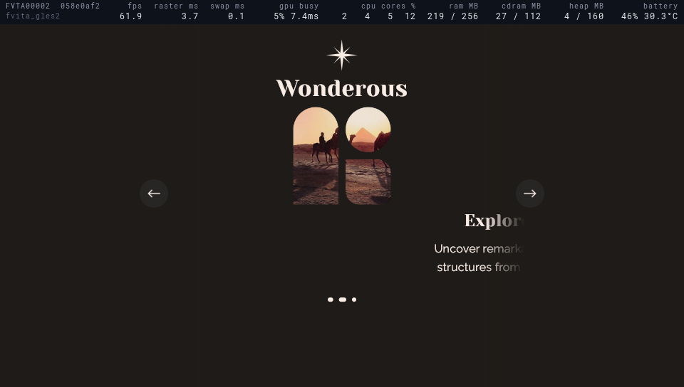
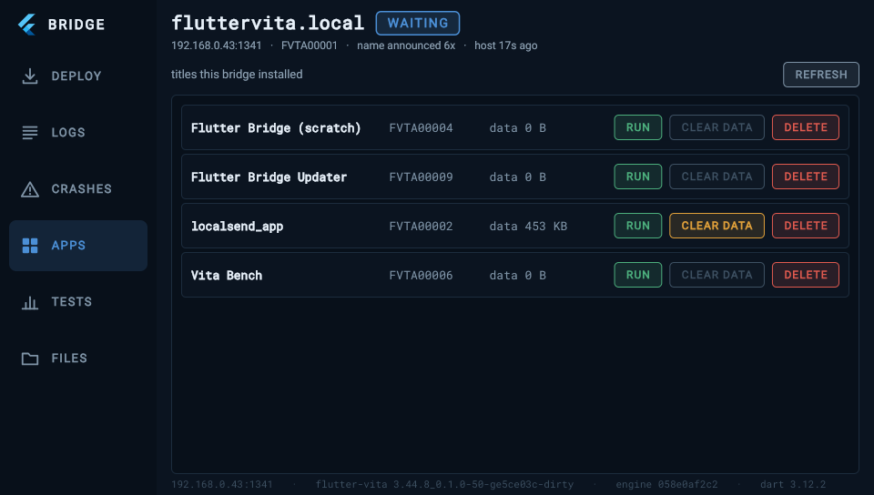
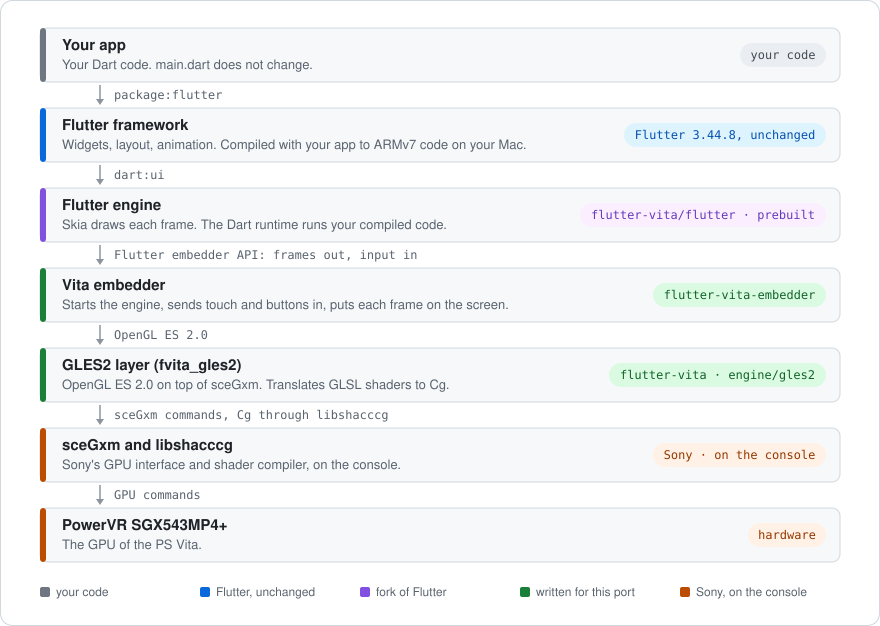

# Flutter for the PlayStation Vita

Flutter apps on the PS Vita. The Flutter engine and framework, compiled for
`arm-vita-eabi`, draw through the console's GPU. Your `main.dart` does not
change.

| | |
|---|---|
|  |  |
| **Wonderous**, an app we did not write, at 60 fps. The debug strip across the top shows the live numbers. | **LocalSend**, file transfer over the local network. We did not write it either. |
|  |  |
| **The gallery**: widgets, tests and hardware checks. | **The bridge** installs your app over Wi-Fi and keeps its logs. |

## Quick start

You need a PS Vita with HENkaku or h-encore² (firmware 3.60 to 3.74), a Mac
with Apple silicon, and VitaSDK. You do not install Flutter: the first
`flutter-vita` command downloads Flutter 3.44.8 for the tool's own use.

```sh
git clone --recurse-submodules https://github.com/flutter-vita/flutter-vita
cd flutter-vita
export PATH="$PWD/cli:$PATH"
flutter-vita precache
flutter-vita doctor
flutter-vita run samples/gallery
```

Before the first run, install the bridge on the console. You do this one
time, with VitaShell. The full steps:

1. [Install the toolchain](https://github.com/flutter-vita/flutter-vita/blob/master/docs/install-macos.md) (macOS) or [on Linux](https://github.com/flutter-vita/flutter-vita/blob/master/docs/install-linux.md).
2. [Set up the console](https://github.com/flutter-vita/flutter-vita/blob/master/docs/configure-console.md): homebrew, the shader compiler, the bridge.
3. [Get started](https://github.com/flutter-vita/flutter-vita/blob/master/docs/get-started.md): the gallery, then your own app.

## How it works



On your Mac, the build compiles your app and the Flutter framework to ARMv7
machine code. It links that code with the prebuilt engine, the embedder and
the GLES2 layer into one `.vpk`. The bridge on the console installs the
`.vpk` and starts it.

## Repositories

| Repository | What it is | Why it exists |
|---|---|---|
| [flutter-vita](https://github.com/flutter-vita/flutter-vita) | The tool: `flutter-vita build`, `install`, `run`, `logs`. Also the bridge, the GLES2 layer, the Vita implementations of twelve plugins, the samples and the docs. **Start here.** | This is the part you use. You build, install, run and debug your app from here. |
| [flutter](https://github.com/flutter-vita/flutter) | Our fork of Flutter, branch `vita-3.44.8`. Its releases carry the prebuilt engine. | The engine does not run on the console without these changes. The prebuilt engine saves you a 12 GB checkout and a long build. |
| [flutter-vita-embedder](https://github.com/flutter-vita/flutter-vita-embedder) | The `main()` of every app. It starts the engine, reads touch, buttons and the keyboard, puts each frame on the screen, and runs the dev server and the debug strip. | Each Flutter platform has an embedder, and this is the one for the Vita. Every app build compiles it from source, so a fix in it needs no new engine. |
| [flutter-vita-packages](https://github.com/flutter-vita/flutter-vita-packages) | Our pub packages: `flutter_vita`, `vita_debug_strip`, `vita_file_browser`. | Your app adds them to `pubspec.yaml` like any other package. `flutter_vita` sets up the app for the console with one call in `main()`. |
| [flutter-vita-bench](https://github.com/flutter-vita/flutter-vita-bench) | The benchmark: a Flutter app with 36 scenes, and a script that compares each run with a baseline. | When the engine, the GLES2 layer or the embedder changes, it tells which scenes got slower. It builds with `flutter-vita` like any other app. |
| [dart-sdk](https://github.com/flutter-vita/dart-sdk) | Fork of [dart-lang/sdk](https://github.com/dart-lang/sdk). | The Dart VM needs an operating-system layer for the Vita: threads, memory, files, the network and secure connections. |
| [skia](https://github.com/flutter-vita/skia) | Fork of [google/skia](https://github.com/google/skia), the library that draws each frame. | Skia must recognize the console as a platform. It reads files with `mmap`, which the console does not have. |
| [abseil-cpp](https://github.com/flutter-vita/abseil-cpp) | Fork of [abseil/abseil-cpp](https://github.com/abseil/abseil-cpp), a C++ library the engine uses. | Some of its code needs ELF data, the `tm_gmtoff` time field and `mmap`. The console does not have them. |
| [boringssl](https://github.com/flutter-vita/boringssl) | Fork of [google/boringssl](https://github.com/google/boringssl), the TLS library. | It needs a source of random numbers. On the Vita that is the kernel's random number generator. |
| [zlib](https://github.com/flutter-vita/zlib) | A copy of Chromium's zlib. | It has code for ARMv8 that the Vita's ARMv7 CPU cannot run. GitHub does not carry Chromium's zlib, so this is a copy, not a fork. |

All changes are commits on branch `vita-3.44.8` of each fork. There are no
patch files.

## Example apps

Real Flutter apps that other people wrote. We run them on the console to
find the bugs that our own apps do not find. Each app tests a different
area. Where an app needs changes, the changes are commits on branch
`vita-3.44.8` of our fork.

| App | What it is | What it tests on the Vita | What we change |
|---|---|---|---|
| [flutter-wonderous-app](https://github.com/flutter-vita/flutter-wonderous-app) | A showcase app by [gskinner and the Flutter team](https://github.com/gskinnerTeam/flutter-wonderous-app) about famous structures of the world. | Animation and many large images. The `.vpk` is 58 MB. | 1 commit: the Vita implementations of the plugins it uses. |
| [localsend](https://github.com/flutter-vita/localsend) | [LocalSend](https://github.com/localsend/localsend), an open-source alternative to AirDrop. | The network: an HTTP server and device discovery on the local network. Version 1.15.4, the last release without Rust code. | 2 commits: pure Dart in place of desktop code, the Vita plugins, and "open file" through VitaShell. |
| [flutter_manga_reader](https://github.com/flutter-vita/flutter_manga_reader) | [A manga reader](https://github.com/TesteurManiak/flutter_manga_reader) for many platforms. | Content from the internet, generated code, and a native library that loads after the first frame. | 1 commit: the Vita implementations of the plugins it uses. |
| [keklist_flutter](https://github.com/flutter-vita/keklist_flutter) | [Keklist](https://github.com/resashkin/keklist), a journal app. | Local storage, long lists, and about 60 packages, 20 of them with native code. | 4 commits: the Vita plugins, a start without a store, layouts for the 960×544 screen, and an export with no share target. |

The control app is [material_3_demo](https://github.com/flutter/samples/tree/main/material_3_demo)
from `flutter/samples`, with no changes and no plugins. It must always work.
If it fails, the problem is in the port, not in the app.

## Releases

One tag across the repositories: `<flutter version>_<ours>`, for example
`3.44.8_0.1.0`. Flutter 3.44.8 is pinned; the engine is prebuilt for it.

*PlayStation and PS Vita are trademarks of Sony Interactive Entertainment.
This project is not affiliated with or endorsed by Sony.*
